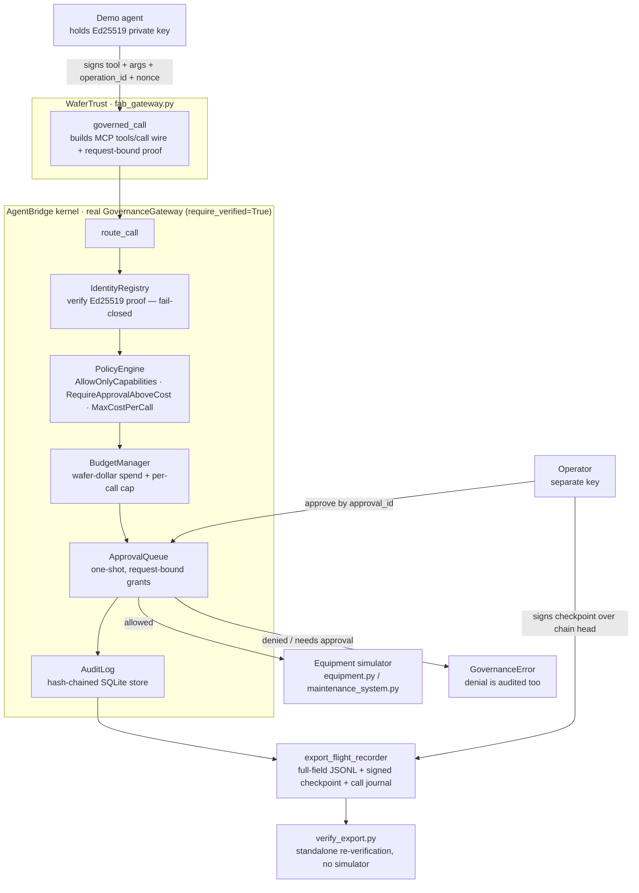

# WaferTrust

[](https://github.com/shadowhunter-92/wafertrust/actions/workflows/tests.yml)

**The trust layer for every wafer.** A neutral governance prototype for AI agents that act on
semiconductor fab equipment — fail-closed Ed25519 caller authentication, a read-only "flight
recorder" with a signed checkpoint, approval-gated writes, and illustrative wafer-dollar risk
budgets. Built on the [AgentBridge](https://github.com/shadowhunter-92/agentbridge) trust kernel.

## The gap

A device-status report is not an agent-action audit trail. SEMI E191 reports
computing-device status, rather than authorizing or recording AI-agent tool calls.
In our simulator, one direct out-of-range setpoint change scraps a 25-wafer lot
(**~$500,000**, assuming $20,000 per wafer). The simulated E191-style report includes
an illustrative `agentAudit = 'none'` extension; this is not a real E191 field.

WaferTrust demonstrates a gateway between an agent and a simulated SECS/GEM equipment
boundary: read calls are logged, and writes require approval and sufficient configured budget.

## What the prototype demonstrates

- **Fail-closed caller authentication.** The kernel runs in production admission mode: every
  call must carry an Ed25519 signature over a canonical payload binding the agent ID, a nonce,
  and the exact request (tool, arguments, operation ID). Unsigned, forged, or mismatched calls
  are denied by the kernel itself, and the denial is audited. An operator-owned capability
  allowlist applies on top of registered identity.
- **Wafer-dollar risk budgets.** Writes carry fixed, illustrative costs: $500,000 for a
  setpoint change, command, or process-job action; $50,000 for a carrier action. A cumulative
  budget and per-call cap apply even after approval. These are not live lot-value estimates,
  and the example shift budget has no automatic shift reset.
- **A durable, hash-chained flight recorder with a signed checkpoint.** Identity, budgets,
  approvals, the operation ledger, and the audit chain share one SQLite store. The full chain
  exports with every field (timestamps, protocols, prev-hash) and re-verifies independently
  from the exported file. A separate operator key signs a checkpoint over the chain head.
  Entries are hash-chained, not individually signed; a checkpoint authenticates its signer's
  statement, not independent custody or the equipment's actual outcome.
- **A call journal.** Every governed call's exact arguments and outcome are recorded and bound
  to its audit entry hash, so the sequence of what ran can be reconstructed afterwards.
- **Fab-first, MCP-wire integration.** Reads, equipment constants, process jobs, and carriers
  are routed through the MCP `tools/call` representation. This is a library demo, not a
  standalone MCP server or a live SECS/GEM connection.
- **Real kernel, not a mock.** Governance uses AgentBridge's actual `GovernanceGateway`
  (`require_verified=True`) for policy, budgets, approvals, and audit. Approval grants are
  one-shot and bound to the exact request: an approved retry must reuse the blocked call's
  operation ID, and a succeeded operation ID cannot be replayed.

The focus is semiconductor workflows and wafer-dollar cost accounting, not a claim that
SECS/GEM governance is otherwise absent. It governs tool access, not process physics:
there is no live interlock, rate-of-change, or cross-tag safety-envelope model.

## What it shows

Same simulated equipment, same demo agent — two outcomes:

- **Ungoverned:** a direct `set_equipment_constant(2001, 500)` call scraps a simulated
  25-wafer lot (**~$500,000**) without a gateway audit.
- **Governed:** reads pass through and are logged; a setpoint write waits for human approval;
  the approved write consumes $500,000 of a configured $600,000 budget; a subsequent
  $500,000 `ABORT` is denied even after approval; an impostor signing with the wrong key is
  denied fail-closed. The exported chain re-verifies from genesis and the signed checkpoint
  verifies `True`. This demonstrates authentication, approval, and budget enforcement, not
  detection of unsafe setpoints or a guarantee of preventing real wafer losses.

## Architecture

The gateway is a thin fab-semantics wrapper; the trust decisions are made by AgentBridge's
real kernel. Every call — allowed or denied — is appended to the hash-chained audit.



## How it maps to the SEMI equipment-cybersecurity standards

*Conceptual alignment, not compliance or certification. The demo runs on simulator stubs.*

| Standard | What it covers | Where WaferTrust fits |
|----------|----------------|------------------------|
| **SEMI E187** — Cybersecurity of Fab Equipment | Baseline hardening of the equipment (OS, network, endpoint). | Complements it: hardening secures the box; WaferTrust governs the **AI-agent access path** to it (identity, authorization, audit). |
| **SEMI E188** — Malware Free Equipment Integration | Malware-free delivery, installation, and maintenance. | Supports the intent: approval-gated, logged writes make changes during maintenance/integration **authorized and attributable** (not a substitute for malware scanning). |
| **SEMI E191** — Computing Device Cybersecurity Status Reporting | Reports device ID and OS/security status. | Fills the blind spot: E191 reports device status, **not agent actions**. The flight recorder adds the missing agent-action audit trail. The demo extends a simulated E191-style report with an `agentAudit` field to show today's gap (`'none'`). |

## Demos

| File | Scenario |
|------|----------|
| `demo.py` | SECS/GEM equipment: 7 scenes (ungoverned scrap → governed reads → approval-gated write → budget circuit breaker → impersonation denied → complete signed export). |
| `maintenance_demo.py` | Maintenance/facilities wedge: read-only flight recorder + approval-gated `dispatch_work_order` + impersonation denied (6 scenes). |
| `verify_export.py` | Standalone verifier: re-checks an exported chain, checkpoint signature, and journal linkage without the simulator. |
| `test_hardening.py` | 14 tests: fail-closed authentication, request-bound approvals, budget breaker, idempotency, export/checkpoint tamper detection. |
| `equipment.py` | In-process SECS/GEM equipment simulator. Mirrors the go-factory-io / secsgem-mcp-server data model (SV, EC, alarms, process jobs, carriers, E191-style report) so the demo runs laptop-only. |
| `maintenance_system.py` | Maintenance-system stub (assets, sensors, work orders). |
| `fab_gateway.py` | Governance gateway wrapping AgentBridge's trust kernel; governs 6 read + 4 write tools at the MCP boundary with request-bound signed proofs. |

## Artifacts (the proof)

- `audit-flight-recorder.jsonl`, `maintenance-flight-recorder.jsonl` — complete audit exports:
  every field of every entry (seq, timestamp, actor, action, protocols, capability, decision,
  reason, cost, prev_hash, entry_hash). Independently verifiable from the file alone.
- `audit-checkpoint.json`, `maintenance-checkpoint.json` — Ed25519-signed checkpoints over the
  chain head, produced with a separate operator key.
- `audit-call-journal.jsonl`, `maintenance-call-journal.jsonl` — exact tool arguments and
  outcomes for every governed call, bound to audit entry hashes.
- `secsgem-run-log.txt`, `maintenance-run-log.txt` — console run logs from the current code.

Verify any export yourself (requires the AgentBridge clone, no simulator):

```bash
python verify_export.py audit
python verify_export.py maintenance
```

The hash chain detects edits within the retained history; it is not WORM storage or
independent proof of a destination effect. Demo keys are generated fresh per run; a real
deployment needs durable key custody and an external anchor for checkpoints.

## Quickstart

Python 3.12+ and Git. Clone the demo and the AgentBridge kernel as siblings, install the
pinned dependencies, and run — one paste in Git Bash (Linux/macOS: swap the activate line):

```bash
git clone https://github.com/shadowhunter-92/wafertrust
git clone https://github.com/shadowhunter-92/agentbridge
cd wafertrust
python -m venv .venv
source .venv/Scripts/activate        # Linux/macOS: source .venv/bin/activate
pip install -r requirements.txt

PYTHONUTF8=1 python demo.py
PYTHONUTF8=1 python maintenance_demo.py
PYTHONUTF8=1 python -m unittest test_hardening -v
python verify_export.py audit
python verify_export.py maintenance
```

`fab_gateway.py` resolves the kernel at `../agentbridge`, so the two folders must stay
siblings. The same steps run in CI ([`.github/workflows/tests.yml`](.github/workflows/tests.yml)),
which pins the kernel to a verified commit.

### What a run looks like

Captured verbatim from a real `demo.py` run (approval IDs and hashes are regenerated each
run; full transcript in [`secsgem-run-log.txt`](secsgem-run-log.txt)):

```text
SCENE 1 — UNGOVERNED: an agent changes a setpoint directly
  Result: {'ok': False, 'scrappedWafers': 25, 'damageUsd': 500000, 'reason': '500.0 outside [200,450]'}
  >> 25 wafers scrapped, $500,000 lost,
     and NO tamper-evident record of who did it or why.

SCENE 3 — GOVERNED: a write is BLOCKED pending human approval
  [write] BLOCKED  approval required for 'set_equipment_constant'

SCENE 4 — Human approves; the write executes within budget
  [write] ALLOWED  cost=$500,000  -> {'ok': True, 'ecid': 2001, 'value': 400.0}
  Budget spent $500,000 / $600,000; remaining $100,000

SCENE 5 — Wafer-dollar circuit breaker: budget exhausted
  [write] BLOCKED  spend cap exceeded (500000.0+0+500000.0 > 600000)
  >> Even with approval, the action is denied: it would risk more
     wafer-dollars than the shift budget allows.

SCENE 6 — IMPERSONATION: a forged call is denied fail-closed
  [forged] BLOCKED  request-bound signed agent proof required

SCENE 7 — The flight recorder: complete, signed, independently verifiable
  Audit integrity verified (durable chain): True
  Signed checkpoint (operator key) -> audit-checkpoint.json: verified True
  Independent re-verification from the exported file: True
```

Each demo run recreates its own SQLite governance store (`*.sqlite3`, gitignored); the
exported JSONL/checkpoint/journal files are the shareable evidence. `fab_gateway.py` sets
`AGENTBRIDGE_ENV=production` process-wide for fail-closed admission — this is a single-process
demo, not a mixed-mode library. The equipment/maintenance systems are laptop-only simulator
stubs, with no real fab hardware. A real integration would need an actual equipment connector,
durable operator key custody, externally anchored checkpoints, and deployment-specific risk
policies. Those are not implemented here. **Engineering alpha — a prototype, not a production
system.**

## Status & what I'm looking for

Independent, bootstrapped, validating whether this is worth building. I'm looking for
**critique and design partners** — fab automation / OT-security practitioners and the
maintainers of SECS/GEM and OPC UA agent bridges — to pressure-test the risk model and tell
me where a neutral audit/approval gate should sit (driver, sidecar, or host). No pitch.

See [THREAT_MODEL.md](THREAT_MODEL.md) for the assets, trust boundaries, tested mitigations,
and the explicit non-goals (no process-physics safety, no WORM, no durable key custody).

## License

WaferTrust is licensed under the [Apache License 2.0](LICENSE).
Copyright 2026 Haider Ali. Built on AgentBridge (Apache-2.0).